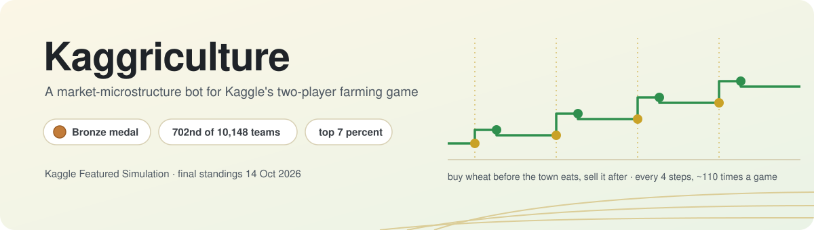
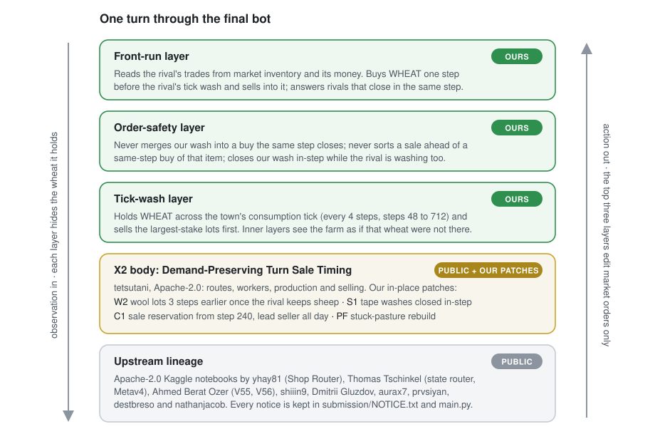
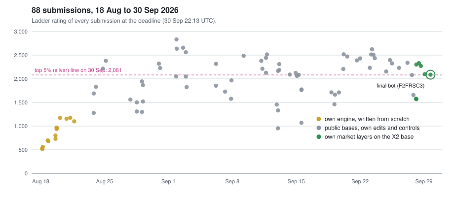

<p align="center">
  
</p>

<p align="center">
  <a href="https://www.kaggle.com/competitions/kaggriculture">Competition</a> ·
  <a href="docs/how-it-works.md">How it works</a> ·
  <a href="docs/evaluation.md">How we tested it</a> ·
  <a href="docs/our-changes.patch">Our diff</a> ·
  <a href="#credits">Credits</a>
</p>

Our final entry to Kaggle's [Kaggriculture](https://www.kaggle.com/competitions/kaggriculture) simulation competition: a two-player
farming game decided in a shared market. The bot finished **702nd of 10,148 teams** and earned a **bronze medal**.

> [!NOTE]
> **Built on public code.** The bot is a public Apache-2.0 bot, tetsutani's
> [Demand-Preserving Turn Sale Timing](https://www.kaggle.com/code/tetsutani/demand-preserving-turn-sale-timing) (itself built on work
> by yhay81, Thomas Tschinkel, Ahmed Berat Ozer and others), plus our own layers. **893 of its 11,025 lines are ours** (888 new,
> 5 edited); [`docs/our-changes.patch`](docs/our-changes.patch) shows every one of them. All upstream notices ship unchanged in
> [`submission/`](submission/), and every author is listed under [Credits](#credits).

## Result

| Final standing | **702nd of 10,148 teams** · bronze medal (top 7%) |
|---|---|
| Final tournament score | 4,457.8 for this bot; its one-line twin scored 4,450.8 |
| Public ladder at the submission deadline | 486th, rating 2,087; the top-5% line was 2,081 |
| Work | 88 submissions over 44 days, solo team |

Kaggle ran two different rankings. The public ladder is a rating that moves after every game; at the deadline it had us 486th, inside
the silver line. The final standings came from a separate Bradley-Terry fit on wins and losses over the whole competition, on its own
scale; there we placed 702nd. Our goal was silver (507th or better), so we missed it by 195 places.

## The game in 30 seconds

Two farms share one town and one market for 720 steps (30 days of 24 hours). Each player plants crops, raises animals, hires hands and
sells. Selling pushes a product's price down; the town buys products back on a fixed clock, which pushes it up again. The richer farm
after day 30 wins. Rankings count wins and losses only, never the margin.

## The idea

Every 4 steps the town eats about 3 units of WHEAT, right after both players' market orders run. So wheat held across that moment
sells back at a slightly higher price than it was bought at: a tenth of a coin per unit, about 110 times a game.

Much of the late field ran forks of the same public bot, and many of them washed wheat on the same clock. Once everyone makes the
obvious trade, the edge moves to **order and timing**: which queue slot trades first, who holds and who closes, and who sees the other
coming. Our layers work at that level.

<p align="center">
  
</p>

| layer | what it does | best evidence |
|---|---|---|
| **Front-run** | Reads the rival's trades from market inventory and money; buys one step before its wash and sells into it at queue slot 9 | +66 to +79 coins per hit; misses cost 0.4 to 3 |
| **Order safety** | Fixes two ways the wash leaked coins to rivals that close in the same step | +225 to +348 coins per game where it fires |
| **Tick wash** | Holds wheat across the town's consumption tick; sorts our sales by stake; hidden from the bot below | 9 of 19 lost games flipped in replay |
| **Patches in the base** | Stuck-pasture rebuild, earlier wool lots, same-step close of scripted washes, later premium reservation | wool and wash patches: 25 losses flipped, 0 wins lost, on 166 recorded games |

The engine rules behind each step, and every number, are in [**How it works**](docs/how-it-works.md).

## How we tested it

The public ladder cannot tell two good bots apart in time, so every candidate faced bars written down before its first game: recorded
ladder games replayed with the candidate in our seat, closed-loop pools where the rivals react, a head-to-head against the previous
bot, a timing gate, and a forward holdout of live games played after the code was frozen.

| gate (vs the previous bot) | result |
|---|---|
| 459 recorded ladder games | +5 losses flipped, 0 wins lost |
| 100 paired games head to head | 91-9 |
| 480-game holdout pool | 476-4, no regression |
| 38 live games after the freeze (veto) | +7 flipped, 0 lost |
| slowest quiet turn × 3.8 | 0.62 s, under the 1 s limit |

Full tables, what the tests could not see, and the final-day decision: [**How we tested it**](docs/evaluation.md).

## The campaign

<p align="center">
  
</p>

1. **18 to 21 Aug: our own engine.** Written from scratch: a day planner that values tasks by net present value, then a single greedy
   dispatcher over every (worker, task) pair. It climbed from 525 to 1,177 and stalled far below the public bots (1,700 to 2,400).
2. **23 Aug to 27 Sep: public bases.** We moved to the strongest public bots and tested our edits on them: production knobs, sale
   timing, opening fixes, replay clones of top bots, and a short CPU-only search lane. Most of it failed its gates.
3. **28 to 29 Sep: market layers.** The three layers above, each built from a loss autopsy, gated and shipped within two days.
4. **30 Sep: hold.** A final cloud round found no candidate that passed, so the last upload was not spent.

Most code, replays and gate runs were built by AI coding agents (Claude Code, Codex) from specs and bars written in advance.

## What did not work

- **Our own engine** topped out at 1,177 while public bots passed 2,000.
- **Open-loop replay clones** of top bots' public games scored 953 to 1,729. A replayed plan breaks as soon as the world differs.
- **A CPU cross-entropy search** over a learned premium seller scored 1,460 to 1,714.
- **Exact copies of a public bot** drew 94% of their games against the original. Copying cannot win a race between equals.
- **Market ideas rejected before any game:** a fertilizer wash (−242 coins per game), holding other products across the tick (−22 to
  −834), selling wool first (−6.1K over 29 losses), bigger washes.
- **The top of the ladder.** Against 2,700+ bots the median loss was 11.7K coins. That gap is economy, not market timing, and nothing
  here closes it.

## Run it

```bash
python -m venv .venv && source .venv/bin/activate
pip install -r requirements.txt
python play.py                          # one game vs Kaggle's starter bot
python play.py --opponent self --seed 7
python play.py --games 10 --opponent random
```

On a MacBook, seed 1 ends 138,369 to 3,824 against the starter bot, with a slowest turn of 0.90 s.

## Layout

```
submission/main.py      the file that was scored, unchanged (sha256 b00d2fbf…)
submission/LICENSE.txt  Apache-2.0, as shipped
submission/NOTICE.txt   upstream attribution, as shipped
play.py                 play it locally with kaggle-environments 1.32.7
docs/how-it-works.md    engine facts and every layer
docs/evaluation.md      test design and every gate number
docs/our-changes.patch  our 893 lines (888 new, 5 edited) as a diff against the public X2 file
docs/submissions.csv    all 88 submissions: date, ladder rating at the deadline, phase
assets/                 banner and diagrams
```

Applying the patch to the public X2 `main.py` rebuilds `submission/main.py` byte for byte. Comments inside `main.py` point to lab notes
(`results/v466/…`) that stay in the private lab repository.

<details>
<summary>Checksums</summary>

| file | sha256 |
|---|---|
| `submission/main.py` | `b00d2fbfd08456c55f490542dc8c36df81b1f24b6395f1481fc01a8a28ce70ff` |
| `submission/LICENSE.txt` | `cfc7749b96f63bd31c3c42b5c471bf756814053e847c10f3eb003417bc523d30` |
| `submission/NOTICE.txt` | `82f3cbdc5ee3b4dbbad054b2ba703a8370b6431af573adf10ad92964421e6ea7` |
| submitted archive (not included) | `f54bf576b001024b2beec2726ca7bb6b056e561c48f6df37f48ecfeff5333270` |
| public X2 `main.py` (base of the patch) | `55be5d5f124c8daaaa63c1a29ba4aab096004909666f04748007603c67b7d2a8` |

</details>

## Credits

This bot stands on public Kaggle notebooks, all Apache-2.0:

- **tetsutani**: [Demand-Preserving Turn Sale Timing](https://www.kaggle.com/code/tetsutani/demand-preserving-turn-sale-timing), the direct base
- **shiiin9**: [Your Market List Is an Order Book](https://www.kaggle.com/code/shiiin9/your-market-list-is-an-order-book)
- **Ahmed Berat Ozer**: the V55 controller and [V56 Smarter Seeds and Fertilizer](https://www.kaggle.com/code/ahmedberatozer/kaggriculture-v56-smarter-seeds-and-fertilizer)
- **Thomas Tschinkel**: [the public state router](https://www.kaggle.com/code/thomastschinkel/kaggriculture-93-8-win-rate-public-state-router) and Metav4
- **Yusuke Hayashi (yhay81)**: the [Shop Router](https://www.kaggle.com/code/yhay81/shop-router-0913) line
- **nathanjacob**: [Pipe-16 idle workers](https://www.kaggle.com/code/nathanjacob/kaggriculture-pipe16-idle-workers)
- **Dmitrii Gluzdov**: the seven-turn rescue and its integration
- **aurax7**: the Reactive Router's sale timing and shed projection
- **prvsiyan** (production and timing) and **destbreso**, credited in the source
- **Kaggle and the kaggle-environments contributors**: the game engine

None of them reviewed or endorsed this repository. The full chain of notices is in [`submission/NOTICE.txt`](submission/NOTICE.txt) and
at the top of [`submission/main.py`](submission/main.py).

## License

[Apache-2.0](LICENSE), inherited from the upstream bots. `submission/` is exactly as submitted; our documents, `play.py` and the
diagrams are released under the same license.
